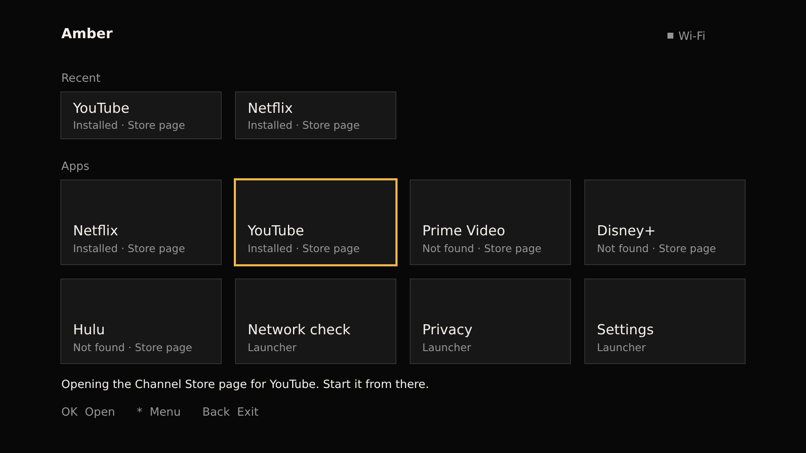

# Design system

## Tokens

| Token | Value | BrightScript/XML | Use |
|---|---|---|---|
| Background | #080808 | `0x080808FF` | Screen, splash, icon field |
| Primary text | #F2F0EA | `0xF2F0EAFF` | Labels, focused menu items |
| Secondary text | #969696 | `0x969696FF` | Headings, hints, tile status, unfocused items |
| Accent amber | #F2B84B | `0xF2B84BFF` | Focus rings and bars, the offline dot. Nothing else |
| Tile background | #171717 | `0x171717FF` | Tiles, buttons, drawer panel |
| Subtle border | #333333 | `0x333333FF` | Unfocused tile borders, dividers |

All colors are opaque (alpha `FF`): no alpha blending anywhere. `npm run audit:tokens` fails if any color literal in `components/` or `manifest` is not one of these.

## Layout (1920×1080)

- 146 px side margins. Content width is 1628 px: 4 columns of 380 px with 36 px gaps.
- Header at y=60: wordmark on the left, network status on the right.
- Recent: heading at 170, one row of up to 4 short tiles (380×110) at 220.
- Apps: heading at 380, grid of 380×200 tiles at 430 (2 rows for the shipped 8 tiles).
- Message line at 900, key hints at 966. Everything sits inside the 5% title-safe area.
- Fonts: Roku system fonts only (`SmallSystemFont`, `MediumSystemFont`, `MediumBoldSystemFont`).

## Focus

- Exactly one focused element on screen at a time.
- Tiles and buttons: a 5 px amber ring when focused, a 2 px #333333 border otherwise. Focus changes only the frame's color and size.
- Lists (drawer, Settings sections): a 6 px amber bar and primary-color text. The Settings bar turns grey while focus is in the buttons, so you can see which section you're in.
- No motion of any kind: no Animation or interpolator nodes, no animated focus (MarkupGrid and RowList are avoided for this reason), no timers, no clock.

## Preview

An **approximate** browser render using the same coordinates and colors as the XML, with a generic sans-serif standing in for Roku's system font. It was made to check spacing and balance, not to show how a TV renders. Text metrics on the device will differ.
